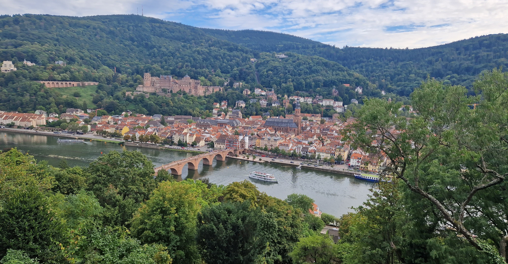

I'm Maria Paola — Paola for short. I am a computational astrophysicist modelling how black holes grow from stellar to intermediate and supermassive masses, and what their gravitational-wave mergers reveal about the early Universe. I showed that AGN disks can grow black holes through the pair-instability gap into the intermediate-mass range — but only in low-viscosity disks with efficient gas hardening — and that the resulting populations match systems like GW190521 and GW231123.

I am a PhD candidate at the [Institute of Theoretical Astrophysics (ITA/ZAH)](https://www.zah.uni-heidelberg.de/welcome), Heidelberg University, in the [DEMOBLACK](http://demoblack.com/) group.

**Research interests:** intermediate-mass black holes · AGN disk dynamics · star cluster dynamics · gravitational-wave sources · stellar collisions · Einstein Telescope science

You can reach me by email at [mariapaolavaccaro@gmail.com](mailto:mariapaolavaccaro@gmail.com) or in Office 161 at ITA, Heidelberg.

<figure style="text-align: center; max-width: 820px; margin: auto;">

<figcaption>A view of Heidelberg</figcaption>
</figure>
