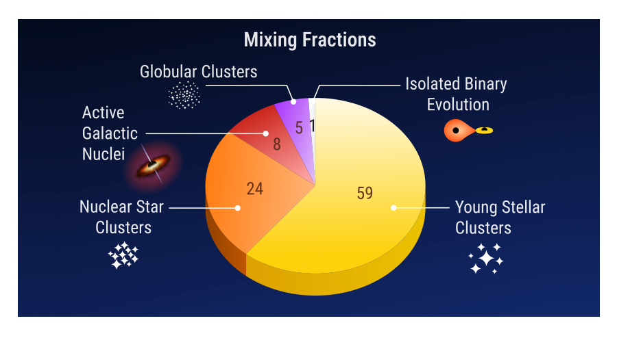
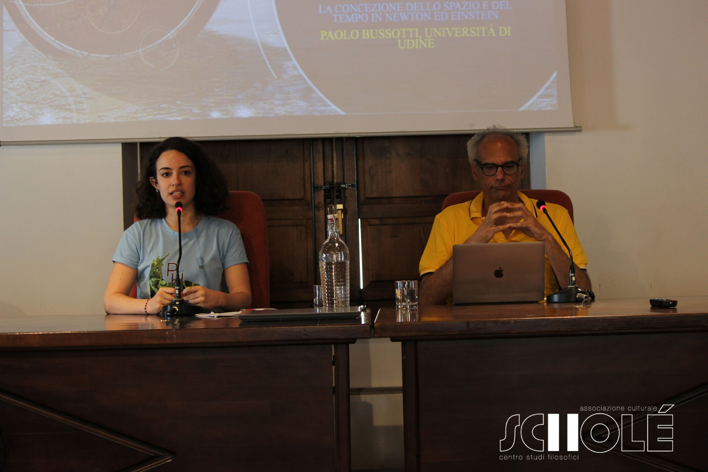

**STRUCTURES Blog** — I wrote about the multiple formation channels of binary black hole mergers, with a special focus on AGN disks and hierarchical assembly, for the Heidelberg STRUCTURES Cluster of Excellence blog. [Read the article](https://structures.uni-heidelberg.de/blog/posts/2025_03/index.php)

<figure style="text-align: center; max-width: 420px; margin: auto;">

<figcaption><em>Blogpost excerpt:</em> Estimate of the proportion of merger events arising from each formation channel, obtained by comparing simulated and observed black hole masses.</figcaption>
</figure>

**Girls' Day "Physik hautnah!"** — I co-organize an annual workshop, *A dance of stars and black holes*, for school-aged students as part of the national Girls' Day programme (2024, 2025, 2026).

**Gist.Science** — My paper on the formation of binary black holes in AGN disks was featured on [Gist.Science](https://gist.science/paper/2508.03637#gist), a platform that makes research accessible to a broad audience. [Read the summary](https://gist.science/paper/2508.03637#gist)

**Scholé** — I am a member of the organizing committee of [Scholé](https://www.filosofiaroccella.it/), a nonprofit that brings physics, philosophy, and history to the general public through weekly seminars and an annual Summer School in Calabria, Italy. If you speak Italian, you are welcome to join — sessions are open to everyone, in person or online.

<figure style="text-align: center; max-width: 520px; margin: auto;">

<figcaption>Me and Prof. Paolo Bussotti during the summer school <em>PHYSIS</em> on the relationship between human beings and Nature.</figcaption>
</figure>
