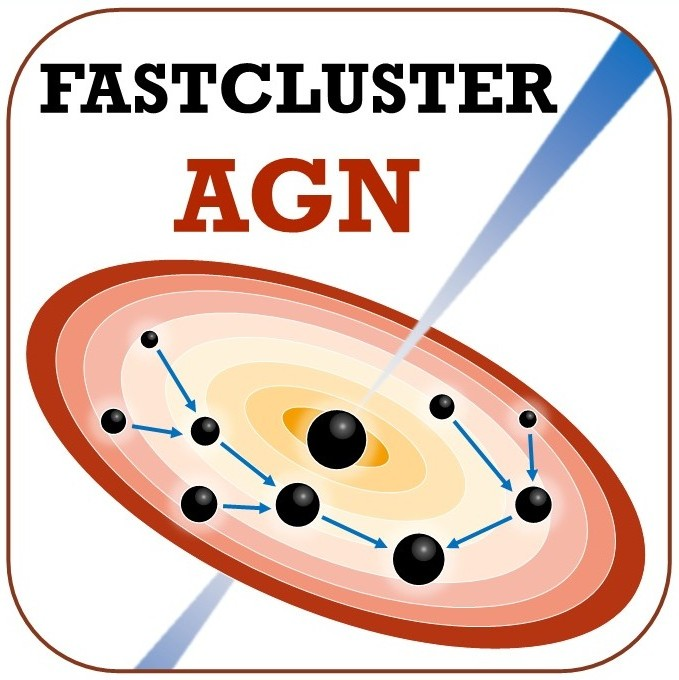

I develop open-source codes for modelling binary black hole populations in dense astrophysical environments. Both packages are publicly available on GitLab.

---

  
  

    <h2 style="margin-bottom: 0.4rem;"><a href="https://gitlab.com/mariapaola.vaccaro/fastcluster_agn">FastClusterAGN</a> <small style="font-size:0.75rem; font-weight:400; color:#888;">v1.0.0</small></h2>
    
Fast semi-analytic model for binary black hole population synthesis in AGN disks, including gas hardening, migration traps, and hierarchical mergers across the AGN parameter space. Associated with publications <a href="/publication/agn-paper-1">Vaccaro et al. 2024</a> and <a href="/publication/agn-paper-3">Vaccaro et al. 2026</a>.

    
<a href="https://gitlab.com/mariapaola.vaccaro/fastcluster_agn" class="btn btn--primary btn--small">GitLab →</a>

  

---

  
  

    <h2 style="margin-bottom: 0.4rem;"><a href="https://gitlab.com/mariapaola.vaccaro/arise">ARISE</a> <small style="font-size:0.75rem; font-weight:400; color:#888;">v0.1.0</small></h2>
    
Code for modelling the cosmic evolution of binary black hole merger rates and populations from AGN disks across redshift. Associated with <a href="/publication/agn-paper-4">Vaccaro et al. 2026 (submitted)</a>.

    
<a href="https://gitlab.com/mariapaola.vaccaro/arise" class="btn btn--primary btn--small">GitLab →</a>

  

